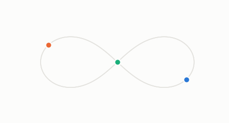
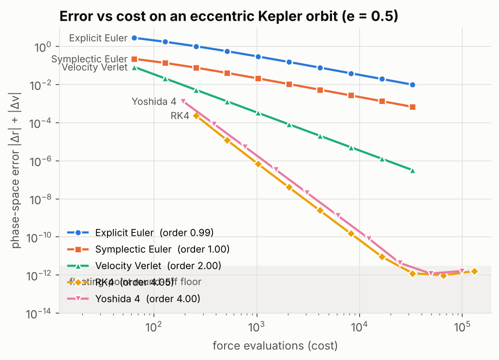
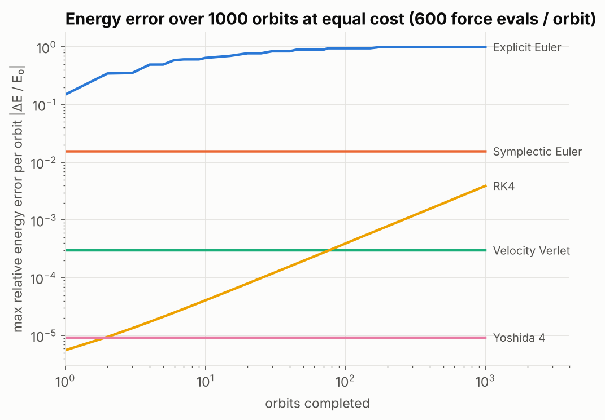
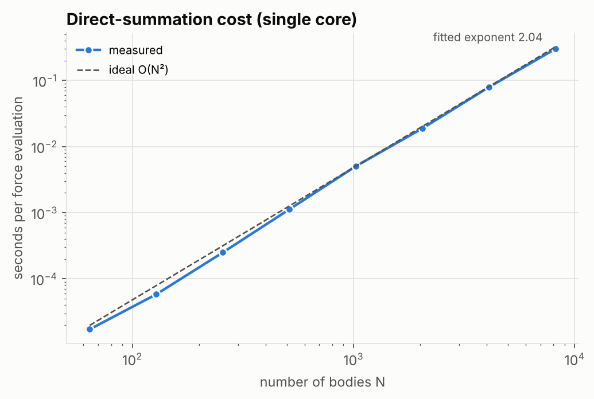
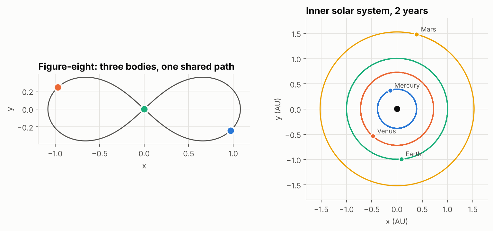

# nbody-sim

A gravitational N-body simulator in modern C++ that compares five time-integration
schemes and verifies each one against analytic solutions and conservation laws.

<p align="center"></p>

The question it answers: **for a fixed compute budget, which integrator should a
long-running orbital simulation use, and why?** Raw accuracy per step is not the
whole answer. Over long runs, *structure preservation* (symplecticity) matters more,
and this project measures that directly.

- Five integrators behind one interface: explicit Euler, symplectic Euler,
  velocity Verlet, classical RK4, and Yoshida's 4th-order symplectic method
- Measured orders of accuracy of 0.99, 1.00, 2.00, 4.05 and 4.00, matching theory
- O(N²) direct summation with Plummer softening; forces are exactly antisymmetric,
  so momentum is conserved to round-off by construction
- 13 automated tests covering force law, conservation, convergence order,
  time-reversibility and known periodic orbits; clean under AddressSanitizer and UBSan
- No dependencies beyond a C++17 compiler and CMake; Python/matplotlib only for plots

## Results

### 1. Each method converges at its theoretical order

<p align="center"></p>

Error after 0.6 of an eccentric (e = 0.5) Kepler orbit, compared against the exact
solution from Kepler's equation and plotted against cost (force evaluations). At about
2,000 force evaluations, explicit Euler is off by 10⁻¹, Verlet by 10⁻⁴ and RK4 by 10⁻⁸.

Both 4th-order methods flatten out near 10⁻¹². That is the double-precision
round-off floor: accumulated rounding over tens of thousands of steps, not a
truncation error. Taking smaller steps past that point makes the answer *worse*.

The study stops at 0.6 of an orbit rather than a full one on purpose. Symplectic
Euler is algebraically leapfrog with an extra half-kick at each end. After exactly
one period those two half-kicks cancel, and a first-order method measures as second
order. An early version of the test suite caught this, and the explanation is
recorded in `tests/test_main.cpp`.

### 2. Over long runs, symplectic beats higher-order

<p align="center"></p>

All methods get the same budget of 600 force evaluations per orbit, for 1,000 orbits.

| Method | Order | Symplectic | Energy error, orbit 1 | Energy error, orbit 1000 |
|---|---|---|---|---|
| Explicit Euler | 1 | no | 1.5 × 10⁻¹ | 9.9 × 10⁻¹ (orbit destroyed) |
| Symplectic Euler | 1 | yes | 1.6 × 10⁻² | 1.6 × 10⁻² |
| Velocity Verlet | 2 | yes | 3.0 × 10⁻⁴ | 3.0 × 10⁻⁴ |
| RK4 | 4 | no | 5.6 × 10⁻⁶ | 3.9 × 10⁻³ |
| Yoshida 4 | 4 | yes | 9.2 × 10⁻⁶ | 9.2 × 10⁻⁶ |

RK4 starts as the most accurate method, but its energy error grows linearly without
bound. It falls behind Yoshida by the second orbit and behind second-order Verlet by
orbit 80. The symplectic methods exactly conserve a slightly perturbed Hamiltonian,
so their energy error oscillates within a fixed band forever.

The plotted quantity is the **largest** error within each orbit. Sampling only at
orbit boundaries looks like slow growth even for symplectic methods: the numerical
orbit precesses, so the boundary sample slides along the in-orbit oscillation.

### 3. Direct summation scales as O(N²)

<p align="center"></p>

On a Plummer-sphere cluster, the cost per force evaluation grows with a fitted
exponent of 2.04, at a steady 1.0–1.4 × 10⁸ pair interactions per second on one
core. The slight excess over an ideal N² comes from the working set outgrowing
the CPU cache at large N. Timings are from a 2.8 GHz Xeon cloud machine, and the
exponent shifts slightly between runs.

<p align="center"></p>

## Methods

The system integrates Newton's equations for N point masses:

```
r_i'' = a_i = G Σ_{j≠i} m_j (r_j − r_i) / (|r_j − r_i|² + ε²)^{3/2}
```

where ε is an optional Plummer softening length that removes the singularity in
close encounters. The potential energy used for diagnostics is softened the same way,
so energy conservation is checked against the Hamiltonian actually being integrated.

| Integrator | Update | Force evals / step |
|---|---|---|
| Explicit Euler | r += h·v, v += h·a(r) using old values | 1 |
| Symplectic Euler | v += h·a(r), then r += h·v | 1 |
| Velocity Verlet | half-kick, drift, half-kick (acceleration cached between steps) | 1 |
| RK4 | classical four-stage Runge–Kutta on (r, v)′ = (v, a(r)) | 4 |
| Yoshida 4 | three leapfrog substeps with weights w₁, w₀, w₁, where w₁ = 1/(2 − 2^{1/3}) and w₀ = −2^{1/3}/(2 − 2^{1/3}) | 3 |

**Design notes**

- **Pairwise symmetric force loop.** Each pair is visited once, and both bodies are
  updated from the same scalar. This halves the work and makes every pairwise force
  exactly equal and opposite in floating point, so total momentum stays at round-off
  for every integrator.
- **No allocation in the hot path.** Each integrator owns its scratch buffers, so
  `step()` does not touch the heap after its first call.
- **Structure-of-arrays state.** Masses, positions and velocities are stored in
  separate contiguous arrays for cache-friendly force evaluation.
- **Reproducible benchmarks.** Random initial conditions are built from raw
  `mt19937` output rather than `std::uniform_real_distribution`, whose output varies
  between standard-library implementations.

## Tests

`ctest` runs 13 tests:

| Area | What is checked |
|---|---|
| Force law | Two-body force matches Newton's law exactly; Newton's third law holds to 10⁻¹³ for 200 bodies; softened force never exceeds its analytic maximum |
| Conservation | All integrators conserve linear momentum to round-off; leapfrog-family methods conserve angular momentum to 10⁻¹¹ over 40 orbits |
| Long-term behavior | Verlet energy error stays bounded over 200 orbits; RK4 energy error grows more than 10× between orbit 10 and orbit 200 |
| Order of accuracy | The least-squares fit of log(error) against log(h) is within 0.25 of each method's theoretical order |
| Symmetry | Verlet run forward, velocities reversed, then run again returns to the start to 10⁻¹¹ |
| Known solutions | Figure-eight orbit closes after one period; Earth returns to its starting point after one year; Kepler solver is periodic and its velocity matches a finite-difference derivative |

## Build and run

Requires CMake 3.16+ and a C++17 compiler (GCC, Clang or MSVC).

```bash
cmake -S . -B build
cmake --build build -j
ctest --test-dir build --output-on-failure
```

Run a simulation:

```bash
./build/nbody --scenario figure8 --integrator yoshida4 --dt 0.001 --t-end 6.3259
```

```
scenario        figure8 (3 bodies)
integrator      yoshida4 (order 4, symplectic)
steps           6326 x dt=0.001
max |dE/E0|     1.951e-12
wall time       0.001 s
```

Scenarios: `kepler`, `figure8`, `solar`, `plummer` (with `--n` bodies). Run
`./build/nbody --help` for all options. Output goes to `trajectory.csv`
(t, body, x, y, z) and `diagnostics.csv` (t, energy, relative energy error,
momentum, angular momentum).

Regenerate every figure in this README (needs Python 3 with matplotlib and Pillow):

```bash
python3 scripts/make_plots.py --build build
```

## Project layout

```
include/nbody/   public headers: Vec3, System, forces, integrators, scenarios
src/             library implementation and the nbody command-line driver
tools/study.cpp  convergence, long-term energy and scaling studies
tests/           self-contained test suite (no third-party framework)
scripts/         plotting
results/         CSV data behind the figures
docs/images/     figures
```

## Possible extensions

- Barnes–Hut tree code for O(N log N) forces on large clusters
- OpenMP parallelization of the force loop, with a strong-scaling study
- Adaptive time stepping for close encounters, and its effect on symplecticity
- Post-Newtonian corrections to reproduce Mercury's perihelion precession

## References

- H. Yoshida, "Construction of higher order symplectic integrators," *Physics Letters A* 150 (1990) 262–268.
- A. Chenciner and R. Montgomery, "A remarkable periodic solution of the three-body problem in the case of equal masses," *Annals of Mathematics* 152 (2000) 881–901.
- S. J. Aarseth, M. Hénon and R. Wielen, "A comparison of numerical methods for the study of star cluster dynamics," *Astronomy and Astrophysics* 37 (1974) 183–187.
- E. Hairer, C. Lubich and G. Wanner, *Geometric Numerical Integration*, 2nd ed., Springer, 2006.

## License

MIT. See [LICENSE](LICENSE).
